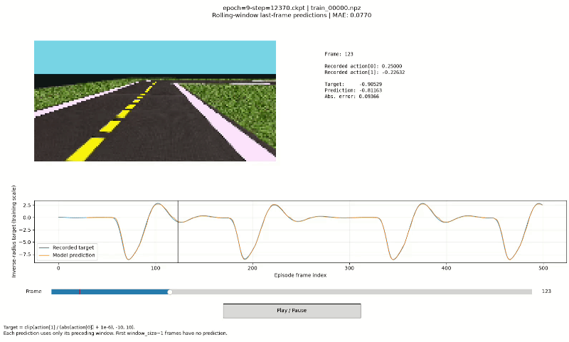
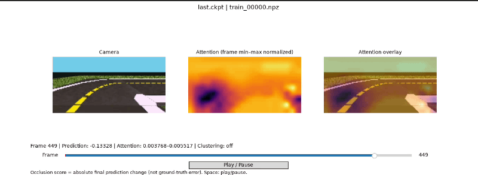

# SelfDriving

Train a CNN + attention + LSTM model on Duckietown camera sequences and compare its predictions with recorded actions.



Attention visualization:



## Setup

Run commands from this project folder. Python 3.9 or newer is required.

```bash
python -m pip install -r requirements.txt
```

## Visualize predictions [Run this]

Replace the checkpoint path below with your saved `.ckpt` file:

```bash
python visualize_checkpoint.py \
  --checkpoint "checkpoints/last.ckpt" \
  --episode test.npz \
  --window-size 30

python visualize_attention.py \
  --checkpoint "checkpoints/last.ckpt" \
  --episode test.npz \
  --window-size 30
```

Use the same window size as training and a checkpoint compatible with the current model architecture. The viewer requires a desktop Matplotlib backend.

The viewer displays camera frames, model predictions versus recorded targets, absolute error, and episode MAE. Each prediction uses the last frame of a rolling window; the initial frames without a complete window are excluded from MAE.

Controls: **Space** to play/pause, **Left/Right** to step, or drag the frame slider.

### Download the dataset

Download the [Google Drive dataset folder](https://drive.google.com/drive/folders/1I7ppQGgy25fwcocjKfcAgVkXBppAbgkc) into `data/` using `gdown`:

```bash
python -m pip install gdown
gdown --folder "https://drive.google.com/drive/folders/1I7ppQGgy25fwcocjKfcAgVkXBppAbgkc" -O data/
```

The folder must be accessible to `gdown`. If it contains ZIP archives, extract them into `data/`. Before training, make sure the episodes follow this structure:

```text
data/
├── train/*.npz
├── validation/*.npz
└── test/*.npz
```

## Reading the dataset

Each `.npz` file contains one driving episode: 501 camera frames and 500 actions, covering about 50 seconds.

- `rgb`: RGB images with shape `(501, 80, 160, 3)`, stored as `uint8`.
- `action`: two recorded control values per step, with shape `(500, 2)`. This project treats them as velocity and yaw rate; their units are not confirmed by the supplied documentation.
- `metadata_json`: episode information, such as map, seed, and split.

Files also include timestamps, rewards, termination flags, and simulator state. Training uses only images and actions.

```python
import numpy as np
import matplotlib.pyplot as plt

with np.load("test.npz", allow_pickle=False) as episode:
    images = episode["rgb"]
    actions = episode["action"]

plt.imshow(images[0])
plt.show()
print("First action:", actions[0])
```

Pair `images[t]` with `actions[t]`. The last image has no action, so use `images[:-1]` when pairing the entire episode.

Load one episode at a time to keep RAM usage low. Keep the supplied splits separate: train has 84 episodes, validation has 18, and test has 18. Test uses the `double_notch` map, which is absent from training and validation.

## Train

```bash
python -u train.py --batch-size 8 --num-workers 2 --window-size 20 --epochs 20 --lr 0.001 --lambda-att 0
```

- `--batch-size`: sequences per batch.
- `--num-workers`: data-loading processes; use `0` to reduce RAM usage or debug loading.
- `--window-size`: consecutive frames per sequence.
- `--epochs`: number of training epochs.
- `--lr`: learning rate.
- `--lambda-att`: attention regularization weight; `0` disables its contribution. The default is `10.0`.
- `--prefetch-factor`: batches prepared per worker; defaults to `1`.
- `--data-dir` and `--log-dir`: dataset and output directories.

See all options with `python train.py --help`. Training uses a GPU when available. Episode order is shuffled each epoch while windows within an episode remain sequential. Validation runs at the end of each epoch.

The model predicts one value per frame, using this target derived from the recorded actions:

```python
target = clip(action[1] / (abs(action[0]) + 1e-6), -10, 10)
```

## Logs and checkpoints

Logs are saved under `logs/self_driving/version_*/`, with checkpoints in its `checkpoints/` subfolder.

```bash
tensorboard --logdir logs
```

TensorBoard shows total, L1, and attention losses for training and validation.


To browse the dataset without a model:

```bash
python preview_dataset.py --file data/test/test_00000.npz
```

### Read a single episode

Print array shapes, data types, and episode metadata:

```bash
python read_episode.py test.npz
```

Display a frame or save it as an image:

```bash
python read_episode.py test.npz --frame 100 --show
python read_episode.py test.npz --frame 100 --save frame100.png
```

The loader is also available in Python:

```python
from read_episode import load_episode

episode = load_episode("test.npz")
images = episode["rgb"]
actions = episode["action"]
metadata = episode["metadata"]
```

## References

The first reference describes the Duckietown platform; it does not establish the provenance of the specific dataset files in this project. The second is a related paper on visual attention for driving, rather than a claim that this code reproduces its complete method.

### Duckietown platform

[Publication](https://doi.org/10.1109/ICRA.2017.7989179)

```bibtex
@inproceedings{paull2017duckietown,
  title     = {{Duckietown}: An Open, Inexpensive and Flexible Platform for Autonomy Education and Research},
  author    = {Paull, Liam and Tani, Jacopo and Ahn, Heejin and Alonso-Mora, Javier and
               Carlone, Luca and Cap, Michal and Chen, Yu Fan and Choi, Changhyun and
               Dusek, Jeff and Fang, Yajun and Hoehener, Daniel and Liu, Shih-Yuan and
               Novitzky, Michael and Okuyama, Igor Franzoni and Pazis, Jason and
               Rosman, Guy and Varricchio, Valerio and Wang, Hsueh-Cheng and
               Yershov, Dmitry and Zhao, Hang and Benjamin, Michael and Carr, Christopher and
               Zuber, Maria and Karaman, Sertac and Frazzoli, Emilio and
               Del Vecchio, Domitilla and Rus, Daniela and How, Jonathan and
               Leonard, John and Censi, Andrea},
  booktitle = {2017 IEEE International Conference on Robotics and Automation (ICRA)},
  year      = {2017},
  publisher = {IEEE},
  doi       = {10.1109/ICRA.2017.7989179},
  url       = {https://doi.org/10.1109/ICRA.2017.7989179}
}
```

### Visual attention for driving

[Paper](https://arxiv.org/abs/1703.10631)

```bibtex
@misc{kim2017interpretable,
  title         = {Interpretable Learning for Self-Driving Cars by Visualizing Causal Attention},
  author        = {Kim, Jinkyu and Canny, John},
  year          = {2017},
  eprint        = {1703.10631},
  archivePrefix = {arXiv},
  primaryClass  = {cs.CV},
  doi           = {10.48550/arXiv.1703.10631},
  url           = {https://arxiv.org/abs/1703.10631}
}
```
